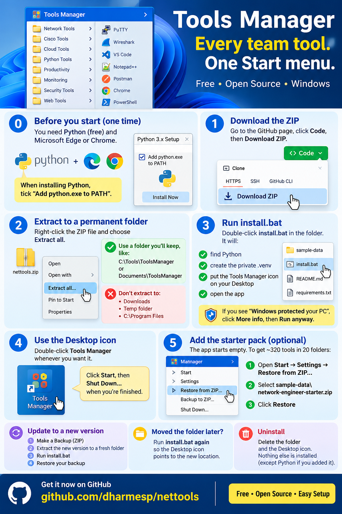

# Tools Manager

A tiny local launcher for the web tools and `.bat` scripts you use every day. Everything opens in its own
**bare popup window** (no address bar, no tabs), and you organise it all from a retro **Windows XP** or
**Windows 98 + 8** style desktop with a Start menu.

It runs entirely on your own PC at `http://localhost:8000`. There is no account, no cloud and no tracking.

## Watch the demo

Click the picture to watch a short video of Tools Manager in action.

## Easy setup (3 steps)

*Click the picture to see it bigger. The steps are written out below too.*

**Step 1. Get the files.**
On this GitHub page, click the green **Code** button, then click **Download ZIP**.
Open the ZIP file and click **Extract all**. (Do not run things from inside the ZIP.)
If you know git, you can do this instead: `git clone https://github.com/dharmesp/nettools.git`

**Step 2. Double-click `install.bat`.**
Wait about one minute. It does everything for you:
it makes the program ready, puts a **Tools Manager** icon on your Desktop, and opens the program.
If Windows says "Windows protected your PC", click **More info**, then **Run anyway**.
(`install.bat` is a plain text file. You can open it with Notepad and read it first.)

**Step 3. Use the Desktop icon.**
Next time, just double-click **Tools Manager** on your Desktop. That is all!

**What if it says Python is missing?**
Python is a free program that Tools Manager needs. `install.bat` opens the download page for you.
Download it, open it, and **tick the box "Add python.exe to PATH"** before you click Install.
Then double-click `install.bat` again.

**How do I close it?**
Click **Start**, then **Shut Down**. Or just close the window.

**Something is not working?**
- Double-click `install.bat` again. It is safe to run many times.
- Moved the folder somewhere else? Run `install.bat` again so the Desktop icon points to the new place.
- Still stuck? Open the file `data\server.log` and look at the last lines. They say what went wrong.

## Features
- **Popup windows without browser chrome**: shortcuts open as clean app windows (Edge or Chrome `--app` mode).
- **Categories as cascading Start-menu folders**, with search and a "Favorites" list of what you use most.
- **Web links and `.bat` / `.cmd` shortcuts**: a BAT shortcut can start a local tool, wait for its port, then open its page.
- **Automatic icons**: icons are fetched from each site; you can also set your own image.
- **Desktop icons**: right-click a shortcut, choose *Add to desktop*, then drag it wherever you like.
- **Drag and drop** a shortcut onto another category, or right-click and choose *Move to category...*.
- **Two themes**: Windows XP (Luna) and Windows 98 menu on a Windows 8 desktop. Switch any time.
- **Backup / Restore / Factory reset**: export everything to a ZIP, restore it later, or wipe it all.
- **Shut Down** from the menu, or just close the window: the server stops itself.

## Requirements
- Windows 10 or 11
- Python 3.9 or newer (tested with 3.12). There is nothing to `pip install`: only the Python standard library is used,
  so `requirements.txt` is empty on purpose.
- Microsoft Edge or Google Chrome

## Run it later
Use the **Tools Manager** icon on your Desktop, or double-click **`run.bat`**. Both start the server with no
console window and open the app. Use **Shut Down** in the Start menu to stop it. If something does not start,
look in `data\server.log`.

## Try the starter pack
`sample-data\network-engineer-starter.zip` contains about 320 hand-picked shortcuts in 20 categories (search engines,
AI tools, vendor knowledge bases, network lookup tools, diagramming, labs and more).
Restore it from the Start menu: **Restore (ZIP)...** (XP) or **Settings > Restore from ZIP...** (Windows 98 + 8).
Restoring *replaces* what you have, so make a backup first.

## Your data
Everything you create is stored in the `data` folder next to the program (`shortcuts.json`, `categories.json`,
`icons/`). It never leaves your PC. Back it up from the menu, or copy the folder.

## Settings (environment variables, all optional)
| Variable | Meaning |
|---|---|
| `TOOLS_PORT` | Port to listen on (default `8000`) |
| `TOOLS_DATA_DIR` | Where to keep your data (default `data` next to `server.py`) |
| `APP_BROWSER` | Full path to the browser `.exe` to use for popup windows |

## Safety notes
- The server listens on `127.0.0.1` only and rejects requests from other websites.
- Shortcuts are launched by their stored id, and only `.bat` / `.cmd` files can be run.
- Only restore backups you trust: a backup can contain shortcuts that run `.bat` files on your PC.

## Project layout
| Path | What it is |
|---|---|
| `server.py` | The whole backend (standard library only) |
| `static/index.html` | The whole front end (one file, no build step) |
| `static/favicon.svg`, `favicon.ico` | App icon |
| `donate.py` | Support links and QR code, compiled into the program |
| `install.bat` | One-click setup: makes the `.venv`, adds the Desktop icon, starts the app |
| `run.bat` | Starts the app |
| `requirements.txt` | Empty on purpose: no extra packages are needed |

## Support the project
If Tools Manager saves you time, you can [buy me a coffee](https://paypal.me/ainetops).
Thank you!

The official project lives at <https://github.com/dharmesp/nettools>. Please download it from there.
